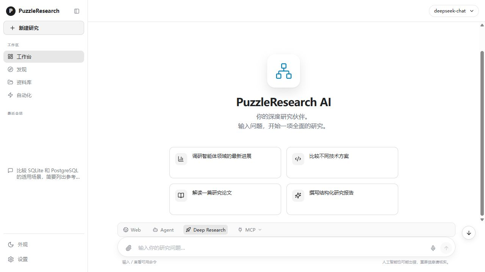
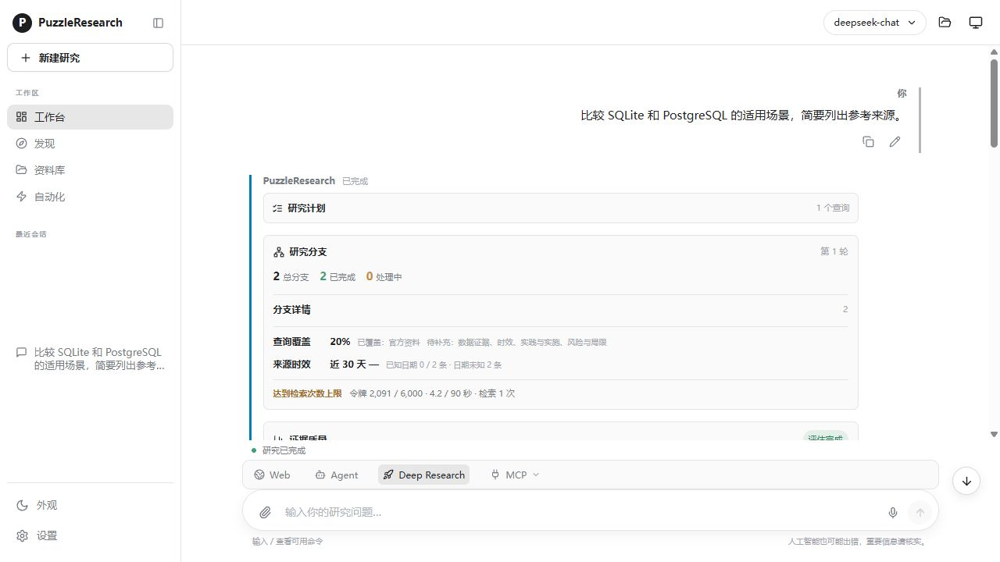
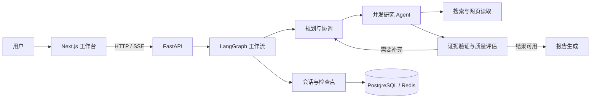

# PuzzleResearch

PuzzleResearch 是一个以 LangGraph 为运行时核心的 AI Agent 研究平台。它组合任务路由、工具调用、多轮与树状 Deep Research、证据与质量控制、会话恢复及中文 Web 工作台。

## 界面预览

上图来自受限预算的真实研究请求，达到检索次数上限时系统会标记结果不完整。

## 当前能力

- FastAPI 服务、LangGraph 工作流、direct / web / agent / deep 路由和 SSE 事件流。
- Agent Profile、多轮工具规划、工具审批与恢复、取消、会话状态和检查点。
- 线性及树状研究、并行搜索、来源抓取、证据整理、知识缺口分析、质量评估和报告修订。
- 搜索 Provider、RAG 文档问答、MCP、浏览器和桌面操作、代码执行与任务清单工具。
- Next.js 工作台、Python 与 TypeScript SDK、音频接口、报告导出、触发器、工作区文件工具。
- PostgreSQL / Redis 配置、Docker 后端部署和基准测试工具。

当前自动化测试命令及本次验收结果见 [`docs/feature-matrix.md`](docs/feature-matrix.md)。仓库包含 Python 与 TypeScript 客户端库；TypeScript SDK 为仓库内私有客户端库，不发布到 npm 包仓库。

## 架构

数据库和 Redis 按配置启用；本地开发可以使用内存存储。模型与搜索服务需要单独配置，工具审批、外部服务和研究预算由运行配置控制。

多用户代理环境可通过 `PUZZLERESEARCH_AUTH_USER_HEADER` 配置可信身份请求头，默认使用 `X-Auth-User`；兼容请求头为 `X-PuzzleResearch-User`。Prometheus 指标使用 `puzzleresearch_` 前缀。身份请求头必须由可信代理设置。

## 技术栈

- Python 3.11、FastAPI、LangChain、LangGraph、Pydantic
- DeepSeek API（模型接口）；搜索 Provider 可按需配置
- Next.js、React、TypeScript
- PostgreSQL checkpoint、Redis Store、ChromaDB 向量检索（按配置启用）
- Playwright、MCP、Docker Compose

