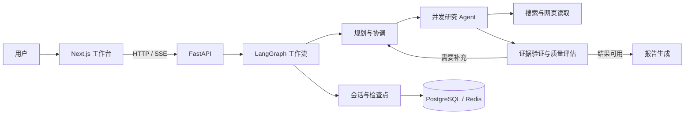

# PuzzleResearch

PuzzleResearch 是一个以 LangGraph 为运行时核心、参考 Weaver 架构手动实现的 AI Agent 研究平台。它组合任务路由、工具调用、多轮与树状 Deep Research、证据与质量控制、会话恢复及中文 Web 工作台；不直接复制或依赖 Weaver 源码。

## 当前能力

- FastAPI 服务、LangGraph 工作流、direct / web / agent / deep 路由和 SSE 事件流。
- Agent Profile、多轮工具规划、工具审批与恢复、取消、会话状态和检查点。
- 线性及树状研究、并行搜索、来源抓取、证据整理、知识缺口分析、质量评估和报告修订。
- 搜索 Provider、RAG 文档问答、MCP、浏览器和桌面操作、代码执行与任务清单工具。
- Next.js 工作台、Python 与 TypeScript SDK、音频接口、报告导出、触发器、工作区文件工具。
- PostgreSQL / Redis 配置、Docker 后端部署和基准测试工具。

当前自动化测试命令及本次验收结果见 [`docs/feature-matrix.md`](docs/feature-matrix.md)。仓库包含 Python 与 TypeScript 客户端库；TypeScript SDK 为仓库内私有客户端库，不发布到 npm 包仓库。

## 架构



数据库和 Redis 按配置启用；本地开发可以使用内存存储。模型与搜索服务需要单独配置，工具审批、外部服务和研究预算由运行配置控制。

## 技术栈

- Python 3.11、FastAPI、LangChain、LangGraph、Pydantic
- DeepSeek API（模型接口）；搜索 Provider 可按需配置
- Next.js、React、TypeScript
- PostgreSQL checkpoint、Redis Store、ChromaDB 向量检索（按配置启用）
- Playwright、MCP、Docker Compose

## 本地运行（Windows PowerShell）

需要 Python 3.11、Node.js 24 和 npm。以下命令从项目根目录执行。首次运行时创建虚拟环境、安装后端依赖并复制配置模板：

```powershell
python -m venv .venv
.venv\Scripts\python.exe -m pip install -r requirements.txt
if (-not (Test-Path .env)) { Copy-Item .env.example .env }
```

在 `.env` 中填写 DeepSeek API Key；搜索、数据库、Redis 等按需配置。不要把 `.env` 或密钥提交到 Git。

前端默认 API 地址为 `http://127.0.0.1:9000`。下面的本地后端使用 `8001`，因此需要在启动 Next.js 前创建 `web/.env.local`，设置：

```dotenv
NEXT_PUBLIC_API_URL=http://127.0.0.1:8001
```

分别在两个终端启动服务：

```powershell
# 终端 1：项目根目录
.venv\Scripts\python.exe -m uvicorn main:app --host 127.0.0.1 --port 8001
```

```powershell
# 终端 2：项目根目录
Set-Location .\web
npm ci
npm run dev
```

前端地址为 `http://localhost:3100`，后端 API 文档为 `http://127.0.0.1:8001/docs`。若端口被占用，应同步修改后端端口与 `NEXT_PUBLIC_API_URL`。

配置模型和搜索服务后，可在前端输入以下演示问题并开启深度研究：

```text
比较 SQLite 和 PostgreSQL 的适用场景，并列出参考来源。
```

工作流会规划子问题、检索并整理来源，再生成报告。实际质量、调用次数和耗时取决于模型、搜索服务与研究预算；演示会产生相应的服务调用费用。

主要流程：用户输入 → 路由与研究规划 → 研究 Agent 检索与汇总证据 → 评估及必要的补充研究 → 报告生成；运行事件通过 SSE 发送到 Web 工作台。

## 测试

```powershell
# Python 全量测试
.venv\Scripts\python.exe -m unittest discover -s tests -v

# Web 构建和测试
Set-Location .\web
npm ci
npm test

# Python SDK 与 TypeScript SDK
Set-Location ..
.venv\Scripts\python.exe -m pip install ./sdk/python
.venv\Scripts\python.exe -m unittest discover -s tests -p "test_sdk*.py" -v
Set-Location .\sdk\typescript
npm ci
npm test
```

测试覆盖 LangGraph 工作流、工具与审批恢复、API、Web 和 SDK。最近一次验收结果和外部服务验证范围见 [功能与验收矩阵](docs/feature-matrix.md)。

测试以 mock 和本地 fixture 为主。真实模型、搜索 Provider、PostgreSQL、Redis、MCP 服务、浏览器/桌面控制以及多用户部署仍需按目标环境配置并做集成验收；自动化通过不代表这些外部服务已经在线。脱敏测试日志位于本地 ignored 目录 `reports/push-preflight/`。

## Docker

安装并启动 Docker Desktop 后，可在项目根目录运行：

```powershell
if (-not (Test-Path .env)) { Copy-Item .env.example .env }
# 先在 .env 中配置所需模型及搜索服务
.\scripts\start-docker.ps1
# 等待容器启动后检查；未就绪时可稍后重试
Invoke-RestMethod http://127.0.0.1:9000/ready
```

启动脚本调用 `docker/compose.yaml`，启动后端、PostgreSQL 和 Redis；后端默认映射到本机 `9000`。Web 前端需单独启动；使用 Docker 默认端口时，不设置 `NEXT_PUBLIC_API_URL` 即可连接。如之前为本地 `8001` 配置了 `web/.env.local`，将其改为 `http://127.0.0.1:9000` 并重新启动前端。

启动脚本会使用 `.docker-secrets/postgres_password`；首次启动且不存在旧数据库卷时会生成密码。已有数据库卷时应保留并使用其原密码。直接运行 Compose 时，需要通过环境变量或 `.env` 提供 `POSTGRES_PASSWORD`；模板中的占位值不能直接用于部署。`.docker-secrets/` 已从 Docker 构建上下文排除。

## Weaver 参考版本

- 上游：[skygazer42/Weaver](https://github.com/skygazer42/Weaver)
- 本地对照版本：`745693afbf1e8a5b68dad5f616b2681cb2042ee9`
- PuzzleResearch 保留自身技术选型，并以独立代码实现对照功能。
